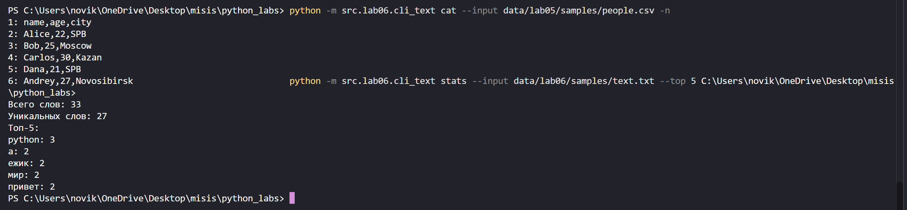
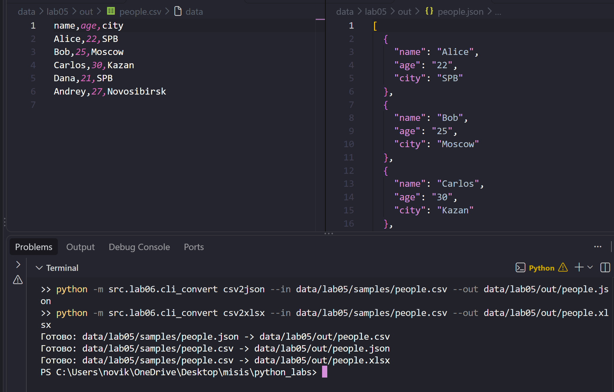

# ЛР6 - CLI-утилиты с argparse (cat/grep-lite + конвертеры)

## Задание A - Текстовые утилиты (cli_text.py)
Модуль создаёт консольную утилиту с двумя подкомандами. `cat --input <путь> [-n]` выводит содержимое файла построчно, а с флагом `-n` добавляет перед каждой строкой её номер. `stats --input <путь> [--top N]` считает частоты слов в файле с помощью функций из ЛР3 (`normalize`, `tokenize`, `count_freq`, `top_n` из `src/lib/text.py`) и печатает общее число слов, число уникальных слов и топ-N самых частых слов (по умолчанию 5). Файл читается функцией `read_text` из ЛР4. Расположен в `src/lab06/cli_text.py`.



## Задание B - Конвертеры (cli_convert.py)
Модуль создаёт консольную утилиту с тремя подкомандами: `json2csv`, `csv2json` и `csv2xlsx`. У каждой два обязательных параметра: `--in` (входной файл) и `--out` (выходной файл). Подкоманды вызывают функции из ЛР5 (`json_to_csv`, `csv_to_json`, `csv_to_xlsx`). Расположен в `src/lab06/cli_convert.py`.



## Способ запуска

Запуск выполняется из **корня репозитория** (там, где лежит папка `src/`), с помощью флага `-m`:

```powershell
python -m src.lab06.cli_text <подкоманда> [параметры]
python -m src.lab06.cli_convert <подкоманда> [параметры]
```

## Сценарии проверки

### 1. cat - вывод файла с нумерацией

```powershell
python -m src.lab06.cli_text cat --input data/lab05/samples/people.csv -n
```

```
1: name,age,city
2: Alice,22,SPB
3: Bob,25,Moscow
4: Carlos,30,Kazan
5: Dana,21,SPB
6: Andrey,27,Novosibirsk
```

Без флага `-n` строки выводятся без номеров:

```powershell
python -m src.lab06.cli_text cat --input data/lab05/samples/people.csv
```

```
name,age,city
Alice,22,SPB
Bob,25,Moscow
Carlos,30,Kazan
Dana,21,SPB
Andrey,27,Novosibirsk
```

### 2. stats - частоты слов

**Вход (`data/lab06/samples/text.txt`):**
```
Привет, мир! Привет, Python!
Python - простой язык, а мир программирования большой.
Мы изучаем Python, чтобы писать простые программы.
По-настоящему интересно, когда программа работает.
Ёлка и ёжик живут в лесу, а ежик любит ёлку.
```

```powershell
python -m src.lab06.cli_text stats --input data/lab06/samples/text.txt --top 5
```

```
Всего слов: 33
Уникальных слов: 27
Топ-5:
python: 3
а: 2
ежик: 2
мир: 2
привет: 2
```

### 3. Конвертеры

```powershell
python -m src.lab06.cli_convert json2csv --in data/lab05/samples/people.json --out data/lab05/out/people.csv
python -m src.lab06.cli_convert csv2json --in data/lab05/samples/people.csv --out data/lab05/out/people.json
python -m src.lab06.cli_convert csv2xlsx --in data/lab05/samples/people.csv --out data/lab05/out/people.xlsx
```

```
Готово: data/lab05/samples/people.json -> data/lab05/out/people.csv
Готово: data/lab05/samples/people.csv -> data/lab05/out/people.json
Готово: data/lab05/samples/people.csv -> data/lab05/out/people.xlsx
```


### 4. Справка --help

Справка работает и для самой утилиты, и для каждой подкоманды, например:

```
$ python -m src.lab06.cli_text --help
usage: cli_text.py [-h] {cat,stats} ...

CLI-утилиты для работы с текстовыми файлами

positional arguments:
  {cat,stats}
    cat        вывести содержимое файла
    stats      частоты слов в тексте

options:
  -h, --help   show this help message and exit
```