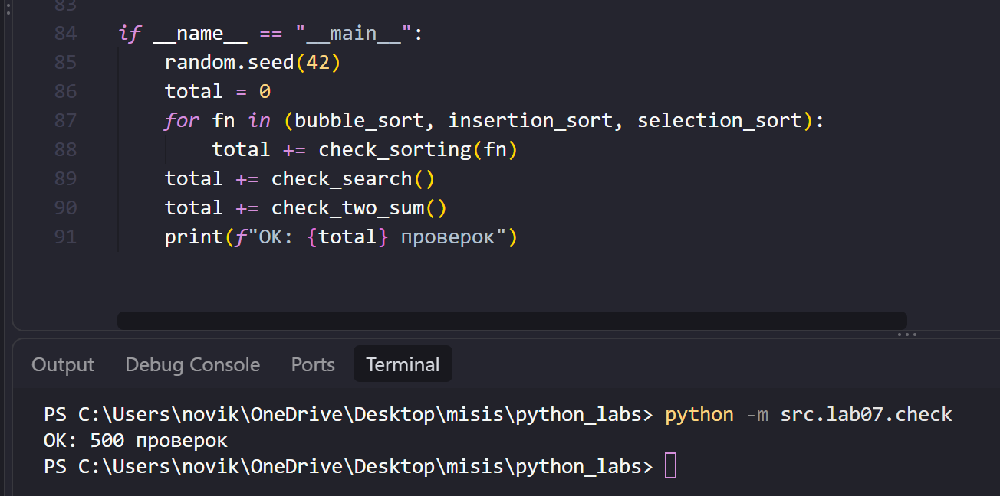
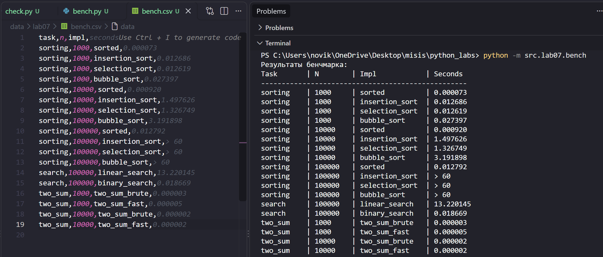

# ЛР7 - Поиск, сортировка и измерение времени

## Задание A - Поиск (search.py)
Модуль содержит четыре функции поиска: `linear_search(nums, x)`, `binary_search(sorted_nums, x)`, `two_sum_brute(nums, target)` и `two_sum_fast(nums, target)`. Расположен в `src/lab07/search.py`.

## Задание B - Сортировки (sorting.py)
Три квадратичные сортировки: `bubble_sort`, `insertion_sort` и `selection_sort`. Расположен в `src/lab07/sorting.py`.

## Задание C - Проверка против эталона (check.py)
Модуль сравнивает написанные функции с эталоном на случайных данных. `check_sorting(fn, trials=100)` сравнивает `fn(nums)` со `sorted(nums)`, а также проверяет, что исходный список не изменился и что вернулся именно новый список. `check_search()` сравнивает `linear_search` с `list.index` (ошибка `ValueError` у `index` соответствует `-1`), а `binary_search` проверяет на отсортированных списках, включая `x`, которого нет. `check_two_sum(trials=100)` сравнивает `two_sum_brute` и `two_sum_fast` между собой и проверяет, что найденная пара корректна. При расхождении поднимается `AssertionError` с данными, на которых оно случилось. Расположен в `src/lab07/check.py`.



## Задание D - Бенчмарк (bench.py)
Модуль измеряет время через `timeit` и печатает таблицу в консоль, а также сохраняет её в `data/lab07/bench.csv`. Расположен в `src/lab07/bench.py`.



---


## Таблица бенчмарка

Таблица взята из `data/lab07/bench.csv`. Время в секундах (для `sorted`, `sort_for_binary` и `two_sum_fast` - среднее по нескольким запускам, остальное - один запуск). Значение `>60` означает, что алгоритм не запускался, потому что по замеру на меньшем `n` заведомо работал бы дольше 60 секунд.

```
task,n,impl,seconds
sorting,1000,sorted,0.000073
sorting,1000,insertion_sort,0.012686
sorting,1000,selection_sort,0.012619
sorting,1000,bubble_sort,0.027397
sorting,10000,sorted,0.000920
sorting,10000,insertion_sort,1.497626
sorting,10000,selection_sort,1.326749
sorting,10000,bubble_sort,3.191898
sorting,100000,sorted,0.012792
sorting,100000,insertion_sort,> 60
sorting,100000,selection_sort,> 60
sorting,100000,bubble_sort,> 60
search,100000,linear_search,13.220145
search,100000,binary_search,0.018669
two_sum,1000,two_sum_brute,0.000003
two_sum,1000,two_sum_fast,0.000005
two_sum,10000,two_sum_brute,0.000002
two_sum,10000,two_sum_fast,0.000002
```

Для `n = 100 000` три квадратичные сортировки не запускались: на `n = 10 000` они заняли 1,2-3,3 с, а время растёт как `n * n`, то есть при росте `n` в 10 раз оно вырастет примерно в 100 раз. Оценка для `n = 100 000` - примерно 120-330 секунд, что больше выбранного лимита в 60 секунд. 

---

## Выводы

**Сортировки.** Пузырёк делает порядка `n * (n - 1) / 2` сравнений: при `n = 1 000` это около 5·10^5 шагов, при `n = 10 000` около 5·10^7, то есть ровно в 100 раз больше. Квадратичная зависимость хорошо видна: 10-кратный рост данных даёт ~100-кратный рост времени. У `sorted` число шагов `n * log n`, то есть при росте `n` в 10 раз шагов становится в 13 раз больше. 

**Поиск.** Бинарный поиск на каждом шаге сравнивает `x` со средним элементом и отбрасывает половину списка. Это правильно только если список отсортирован: тогда "середина меньше `x`" означает "`x` может быть только правее". На неотсортированном списке `x` может лежать в той половине, которую мы выбросили, и функция вернёт `-1`, хотя `x` в списке есть. Поэтому бинарному поиску нужна сортировка, а она стоит дорого, сортировка равна примерно 7 линейным запросам. Значит, сортировка окупается уже примерно после 7 запросов к одному и тому же списку. 

---

## Результат check.py

3 сортировки * 100 тестов = 300 проверок.
Поиск (линейный + бинарный в одном цикле) = 100 проверок.
Two Sum (перебор + хэш-таблица в одном цикле) = 100 проверок.

Всего: 300 + 100 + 100 = 500 автоматических испытаний.

```powershell
python -m src.lab07.check
```

Расхождений не было.

