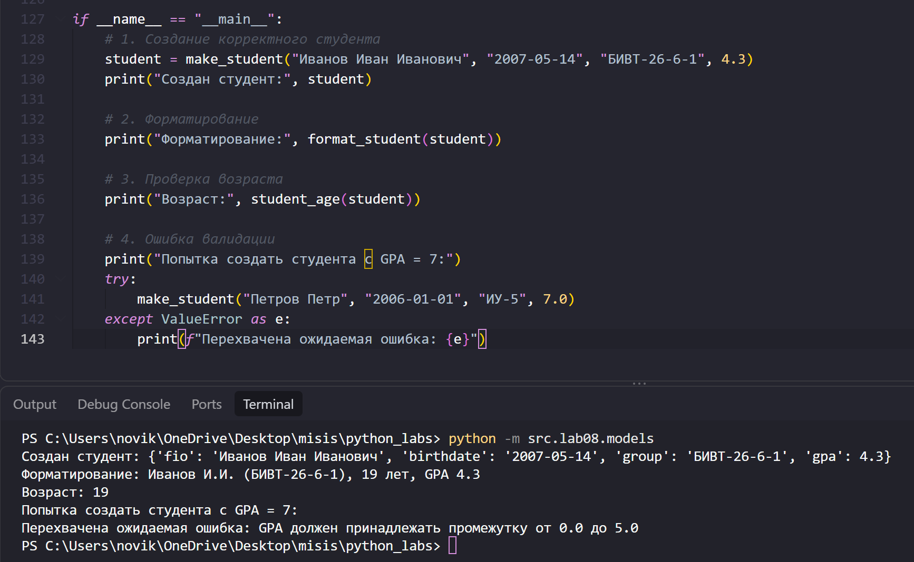
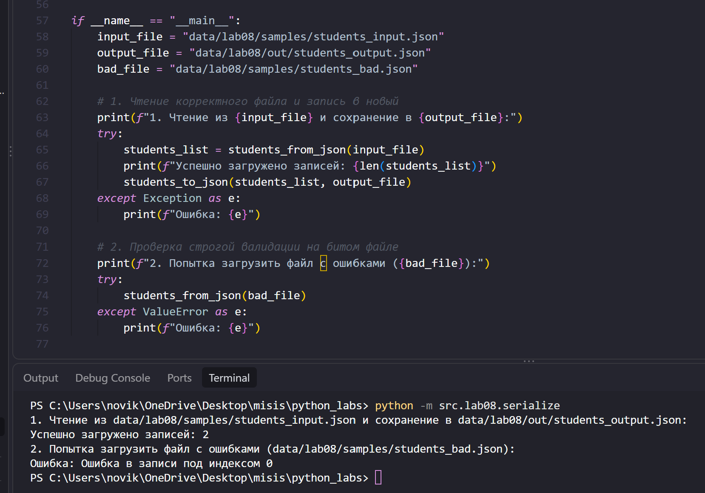

# ЛР8 - Модель данных без классов: запись Student как словарь, валидация и сериализация

## Задание A - Модель данных и функции (`models.py`)

Модель **`Student`** описывает запись в виде словаря с фиксированным набором ключей, закреплённым в константе `STUDENT_FIELDS = ("fio", "birthdate", "group", "gpa")`. Расположен в `src/lab08/models.py`.

### Описание структуры записи и логики функций:
- **`make_student(fio, birthdate, group, gpa) -> dict`** — конструктор записи. Проверяет, что ФИО и группа являются непустыми строками (ФИО содержит как минимум фамилию и имя), дата рождения соответствует формату ISO 8601 (`YYYY-MM-DD`), реально существует (отсеиваются некорректные дни через `date.fromisoformat`) и не находится в будущем, а `gpa` является числом в диапазоне от `0.0` до `5.0` (целые числа приводятся к `float`). Возвращает готовый словарь.

```python
def make_student(fio: str, birthdate: str, group: str, gpa: float | int) -> dict:
    """Конструктор студента: проверяет входные данные и возвращает словарь-запись."""
    if not isinstance(fio, str) or not fio.strip():
        raise ValueError("ФИО должно быть непустой строкой.")
    
    if not isinstance(group, str) or not group.strip():
        raise ValueError("Группа должна быть непустой строкой.")

    fio_parts = fio.split()
    if len(fio_parts) < 2:
        raise ValueError("ФИО должно содержать как минимум фамилию и имя.")

    try:
        b_date = date.fromisoformat(birthdate)
    except ValueError:
        raise ValueError(f"Неверный формат или несуществующая дата рождения '{birthdate}'. Ожидается YYYY-MM-DD.")

    if b_date > date.today():
        raise ValueError("Дата рождения не может быть в будущем.")

    if isinstance(gpa, bool) or not isinstance(gpa, (int, float)):
        raise TypeError("GPA должен быть числом (float или int).")

    gpa_float = float(gpa)
    if not (0.0 <= gpa_float <= 5.0):
        raise ValueError("GPA должен принадлежать промежутку от 0.0 до 5.0")

    return {
        "fio": fio.strip(),
        "birthdate": birthdate.strip(),
        "group": group.strip(),
        "gpa": round(gpa_float, 2)
    }
```
- **`validate_student(rec: dict) -> None`** — проверяет готовый словарь-запись. Убеждается, что набор ключей в точности равен `STUDENT_FIELDS` (нет пропущенных или лишних полей), после чего повторно прогоняет значения через логику конструктора. При нарушении поднимает `ValueError`.
```python
def validate_student(rec: dict) -> None:
    """Проверяет готовый словарь-запись на соответствие структуре и правилам валидации."""
    if not isinstance(rec, dict):
        raise ValueError("Запись студента должна быть словарём.")

    expected = set(STUDENT_FIELDS) # ожидаемые ключи
    actual = set(rec.keys()) # действительные ключи

    # Проверяем ключи, если они не совпадают
    if actual != expected:
        missing = expected - actual 
        extra = actual - expected
        
        details = []
        if missing:
            details.append(f"пропущены {missing}")
        if extra:
            details.append(f"лишние {details}")
            
        raise ValueError(f"Неверный набор полей записи студента: {', '.join(details)}.")

    # Проверяем корректность значений через уже существующий конструктор
    make_student(rec["fio"], rec["birthdate"], rec["group"], rec["gpa"])
```
- **`student_age(rec: dict, today=None) -> int`** — вычисляет полные годы студента на заданную дату `today` (по умолчанию `date.today()`), корректно учитывая, наступил ли уже день рождения в текущем году.
```python
def student_age(rec: dict, today: date | None = None) -> int:
    """Вычисляет полных лет студента на дату today (по умолчанию сегодня)."""
    validate_student(rec)
    b_date = date.fromisoformat(rec["birthdate"])
    ref_date = today or date.today()
    
    if b_date > ref_date:
        raise ValueError("Дата рождения позже целевой даты.")

    age = ref_date.year - b_date.year
    if (ref_date.month, ref_date.day) < (b_date.month, b_date.day):
        age -= 1
    return age
```
- **`format_student(rec: dict) -> str`** — преобразует запись в читаемый вид (например: `Иванов И.И. (БИВТ-26-6-1), 19 лет, GPA 4.30`).
```python
def format_student(rec: dict) -> str:
    """Форматирует запись студента в читаемую строку с инициалами и возрастом."""
    validate_student(rec)
    
    fio_parts = rec["fio"].split()
    surname = fio_parts[0].capitalize()
    initials = "".join(f"{part[0].upper()}." for part in fio_parts[1:])
    
    age = student_age(rec)

    return f"{surname} {initials} ({rec['group']}), {age} лет, GPA {rec['gpa']}"
```
- **`student_to_dict(rec: dict) -> dict`** — валидирует запись и возвращает её **независимую копию** (`dict(rec)`), предотвращая нежелательные мутации данных по ссылке при сериализации.
```python
def student_to_dict(rec: dict) -> dict:
    """Возвращает копию записи для сериализации."""
    validate_student(rec)
    return dict(rec)
```
- **`student_from_dict(d: dict) -> dict`** — осуществляет десериализацию входящего словаря, аккуратно приводит `gpa` к типу `float` (с обработкой возможных исключений) и проводит строгую валидацию.
```python
def student_from_dict(d: dict) -> dict:
    """Десериализует словарь, приводит типы и проверяет запись через валидацию."""
    if not isinstance(d, dict):
        raise ValueError("Ожидался словарь для десериализации студента.")
    
    fio = d.get("fio")
    birthdate = d.get("birthdate")
    group = d.get("group")
    gpa = d.get("gpa")

    if gpa is not None and not isinstance(gpa, bool):
        try:
            gpa = float(gpa)
        except (ValueError, TypeError):
            pass

    rec = {
        "fio": fio,
        "birthdate": birthdate,
        "group": group,
        "gpa": gpa
    }
    
    validate_student(rec)
    return rec
```
### Пример работы models.py:



---

## Задание B - Сериализация и политика обработки ошибок (`serialize.py`)

Модуль отвечает за экспорт и импорт данных в формате JSON. Расположен в `src/lab08/serialize.py`.

- **`students_to_json(students, path)`** — выполняет сериализацию списка студентов в JSON-файл с предварительной валидацией каждого элемента. Параметры: `ensure_ascii=False`, `indent=2`.
```python
def students_to_json(students: list[dict], path: str | Path) -> None:
    """Сохраняет список записей студентов в JSON-файл с предварительной валидацией."""
    check_extension(str(path), ".json")
    
    output_path = Path(path)
    output_path.parent.mkdir(parents=True, exist_ok=True)
    
    # Каждую запись пропускаем через student_to_dict для проверки и создания копии
    validated_list = [student_to_dict(s) for s in students]
    
    with open(output_path, "w", encoding="utf-8") as f:
        json.dump(validated_list, f, ensure_ascii=False, indent=2)
```
- **`students_from_json(path) -> list[dict]`** — читает JSON-файл, преобразует его в список и десериализует каждую запись.
```python
def students_from_json(path: str | Path) -> list[dict]:
    """Загружает список студентов из JSON-файла со строгой валидацией каждой записи.

    Политика обработки битых записей:
    - Строгая (strict): первая же битая запись вызывает ValueError с указанием индекса и причины.
    """
    check_extension(str(path), ".json")
    
    text = read_text(path)

    if text.strip() == "":
        raise ValueError(f"Файл пуст: {path}")

    try:
        data = json.loads(text)
    except json.JSONDecodeError:
        raise ValueError(f"Некорректный формат JSON в файле {path}")

    if not isinstance(data, list):
        raise ValueError("Содержимое JSON-файла должно быть списком.")

    students = []

    for idx, item in enumerate(data):
        try:
            # Десериализация и строгая валидация через модель студента
            student = student_from_dict(item)
            students.append(student)
        except:
            raise ValueError(f"Ошибка в записи под индексом {idx}")

    return students
```

### Политика обработки битых записей (Strict Policy)
В реализации выбрана **строгая политика (`strict`)**: при обнаружении любой некорректной записи в файле (битая дата, недопустимый GPA, лишние ключи) процесс немедленно прерывается с выбросом исключения `ValueError`, содержащего индекс проблемной строки и причину ошибки. Это гарантирует, что в программу не попадут повреждённые или невалидные данные.

### Пример работы serialize.py:

