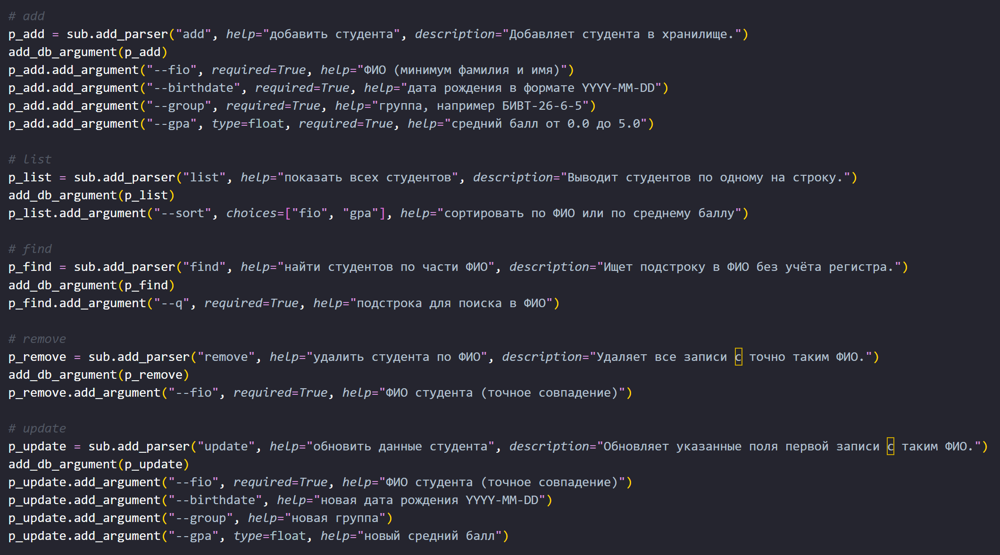
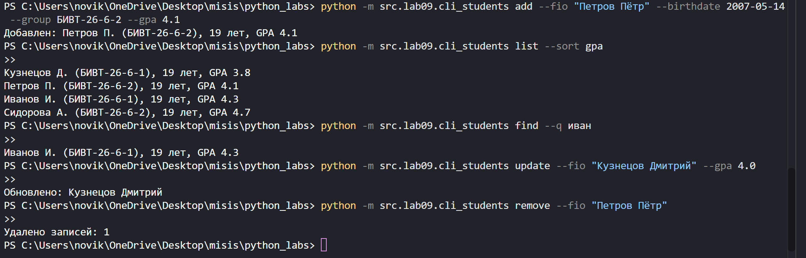
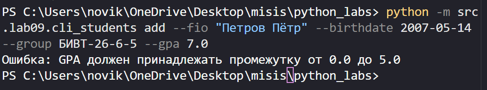

# ЛР9 - «База данных» на CSV: CRUD-функции над students.csv и CLI

## Задание A - Хранилище и CRUD (group.py)
Модуль работает с CSV-файлом как с простейшей базой данных студентов. 
- `ensure_storage(path)` создаёт файл с заголовком `fio,birthdate,group,gpa` (и недостающие папки), если его ещё нет
```python
def ensure_storage(path: str | Path) -> None:
    path = Path(path)

    if path.exists():
        return

    path.parent.mkdir(parents=True, exist_ok=True)
    save_students(path, [])
```
- `load_students(path)` читает файл через `csv.DictReader`, каждую строку пропускает через `student_from_dict` (там же `gpa` из строки становится `float`) и поднимает `ValueError` при неверном заголовке, лишних колонках или некорректной строке (в сообщении номер строки файла)
```python

def load_students(path: str | Path) -> list[dict]:
    ensure_storage(path)

    with open(path, encoding="utf-8", newline="") as f:
        reader = csv.DictReader(f)

        if reader.fieldnames is None:
            raise ValueError(f"В файле {path} нет строки-заголовка")

        if tuple(reader.fieldnames) != STUDENT_FIELDS:
            raise ValueError(f"Неверный заголовок в файле {path}")

        students = []
        # строка 1 - заголовок, поэтому данные начинаются со строки 2
        for line_number, row in enumerate(reader, start=2):
            # DictReader кладёт лишние значения строки под ключ None
            if None in row:
                raise ValueError(f"В строке {line_number} файла {path} больше значений, чем колонок")

            try:
                students.append(student_from_dict(row))
            except (ValueError, TypeError) as error:
                raise ValueError(f"Строка {line_number} файла {path}: {error}") from error

    return students
```
- `save_students(path, students)` сначала проверяет все записи и только потом перезаписывает файл через `csv.DictWriter` (так при ошибке данных старый файл не пропадает). 
```python
def save_students(path: str | Path, students: list[dict]) -> None:
    # Валидация записей
    for student in students:
        validate_student(student)

    rows = [
        [student[field] for field in STUDENT_FIELDS]
        for student in students
    ]

    # Используем готовую универсальную функцию записи CSV
    write_csv(rows, path, header=STUDENT_FIELDS)
```

### CRUD
`add_student` (валидирует запись и дописывает в конец),`list_students(path, sort_by=None)` (`sort_by` может быть `None`, `"fio"` или `"gpa"`, иначе `ValueError`), `find_students` (поиск подстроки в ФИО без учёта регистра), `remove_student` (удаляет **все** записи с таким ФИО, возвращает их количество), `update_student(path, fio, **fields)` (обновляет поля **первой** записи с таким ФИО, неизвестное поле - `KeyError`, результат валидируется, возвращает `True`/`False`). Расположен в `src/lab09/group.py`.

## Задание B - CLI (cli_students.py)
Консольная утилита на `argparse` с подкомандами `add`, `list`, `find`, `remove`, `update`. У каждой подкоманды есть общий параметр `--db` с путём к хранилищу (по умолчанию `data/lab09/students.csv`), он пишется **после** названия подкоманды. Список выводится по одной записи на строку через `format_student` из ЛР8. Ошибки валидации и повреждённый файл выводятся понятным текстом в `stderr` с кодом возврата `1`, ошибки аргументов (`--gpa abc`, неизвестная подкоманда) обрабатывает `argparse` (код `2`). Расположен в `src/lab09/cli_students.py`.



### Пример работы


---

## Формат хранилища

Файл `data/lab09/students.csv`, кодировка UTF-8, разделитель `,`, первая строка - заголовок:

```csv
fio,birthdate,group,gpa
Иванов Иван,2007-10-10,БИВТ-26-6-1,4.3
Сидорова Анна,2007-03-22,БИВТ-26-6-2,4.7
Кузнецов Дмитрий,2006-12-05,БИВТ-26-6-1,3.8
```

## Обработка ошибок 

Например, GPA, не принадлежащий промежутку от 0.0 до 5.0.


