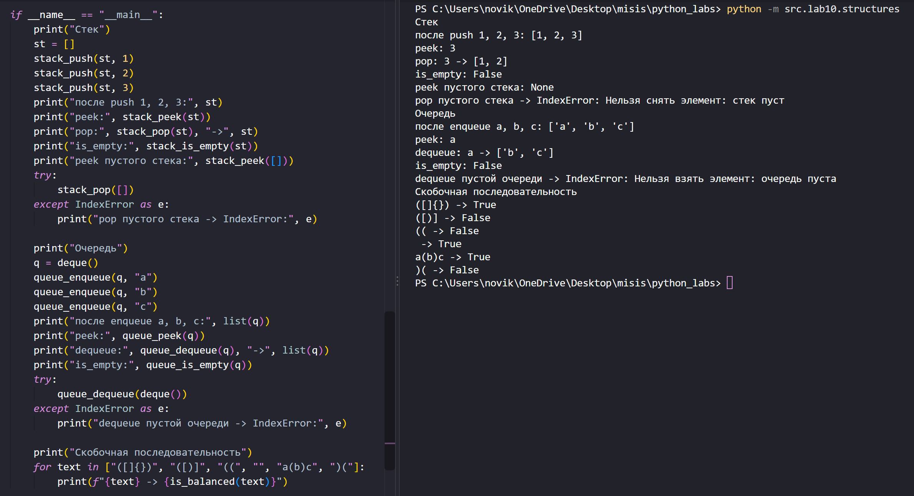
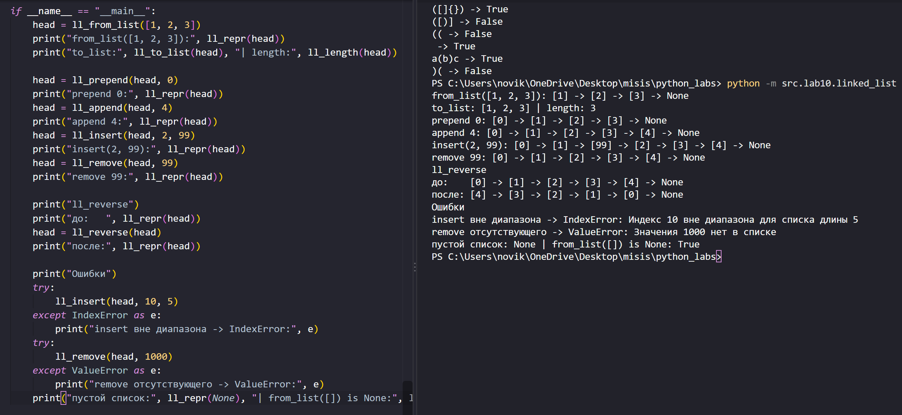
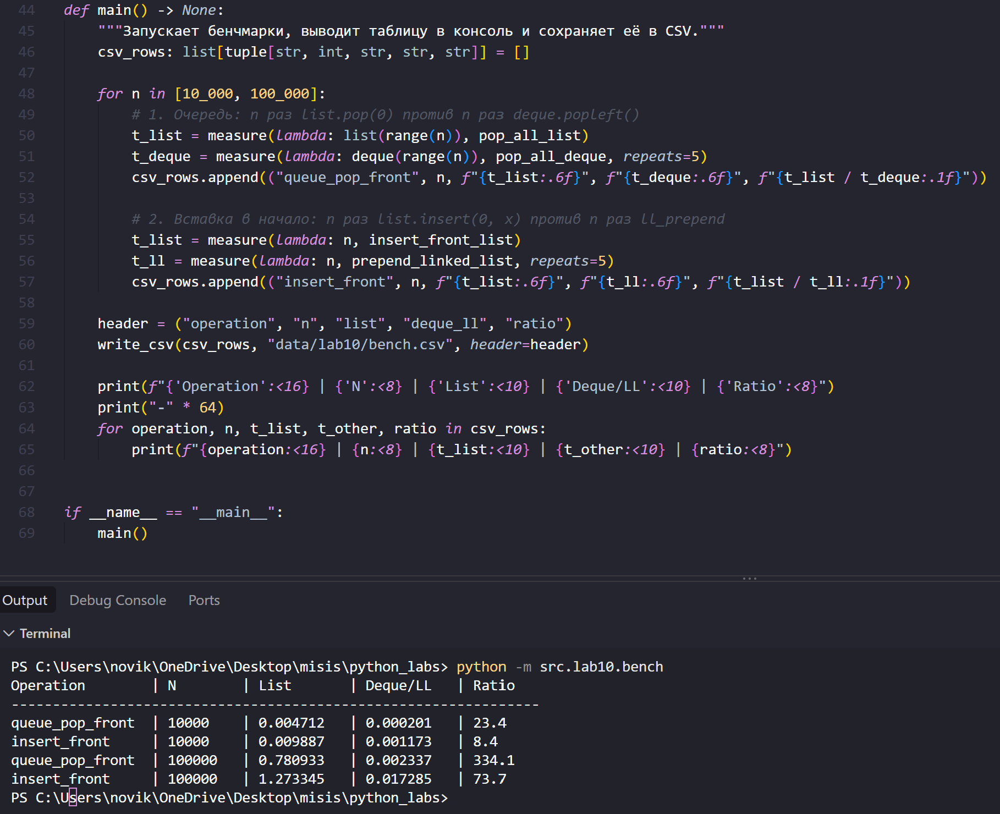

# ЛР10 - Структуры данных: Stack, Queue, Linked List и бенчмарки

## Теория

**Стек** - структура, в которой элементы кладут и забирают только с одного конца. Работает по принципу LIFO: последним пришёл - первым вышел. Стек сделан на обычном `list`: вершина - это последний элемент, поэтому `append` и `pop` с конца работают быстро, за O(1).

**Очередь** - работает по принципу FIFO: первым пришёл - первым вышел. Элементы добавляются в конец, а берутся с начала. Очередь сделана на `collections.deque`: и добавить справа, и забрать слева можно за O(1). На обычном `list` забрать первый элемент (`pop(0)`) долго, за O(n), потому что все остальные элементы приходится сдвигать.

**Связный список** - цепочка узлов. В каждом узле лежит значение и ссылка на следующий узел, а у последнего узла ссылка равна `None`. Весь список задаётся ссылкой на первый узел (голову). Узлы лежат в памяти где угодно, поэтому добавить элемент в начало просто (O(1)), а добраться до элемента по номеру тяжело (O(n)): нужно идти от головы по ссылкам.

Сложность основных операций:

- стек на `list`: добавить, снять, посмотреть вершину - O(1)
- очередь на `deque`: добавить в конец, взять из начала - O(1)
- очередь на `list`: взять из начала через `pop(0)` - O(n)
- связный список: добавить в начало - O(1); добавить в конец, вставить по индексу, удалить, узнать длину, развернуть - O(n)
- обычный `list`: вставка в начало через `insert(0, x)` - O(n), доступ по индексу - O(1)

## Задание A - Стек и очередь (structures.py)

Стек - это функции над `list`: `stack_push` добавляет элемент на вершину, `stack_pop` снимает и возвращает верхний элемент (если стек пуст - `IndexError` с понятным сообщением), `stack_peek` показывает верхний элемент без удаления (если стек пуст - `None`), `stack_is_empty` проверяет, пуст ли стек.

Очередь - это функции над `deque`: `queue_enqueue` добавляет элемент в конец, `queue_dequeue` берёт элемент из начала (если очередь пуста - `IndexError`), `queue_peek` показывает первый элемент без удаления (если пуста - `None`), `queue_is_empty` проверяет, пуста ли очередь.

Функция `is_balanced(s)` проверяет скобки `()`, `[]`, `{}` за один проход со стеком: открывающую скобку кладём в стек, а когда встречаем закрывающую, снимаем верхнюю скобку из стека и смотрим, подходит ли она по паре. Если не подходит или стек уже пуст - последовательность неправильная. В конце стек должен быть пустым. Остальные символы игнорируются.

Файл: `src/lab10/structures.py`. Запуск примеров: `python -m src.lab10.structures`.



## Задание B - Односвязный список (linked_list.py)

Единственный класс в работе - `Node`, у него два поля (`value` и `next`) и только конструктор. Всё остальное сделано функциями. Список задаётся ссылкой на голову: это либо `Node`, либо `None` (пустой список).

Важное правило: голова может измениться (например, при добавлении в начало), поэтому функции, которые могут её изменить, **возвращают новую голову**. Вызывать их нужно с присваиванием: `head = ll_prepend(head, x)`. Если не присвоить результат, `head` так и будет указывать на старую голову.

Функции:

- `ll_from_list(values)` - собирает связный список из обычного списка и возвращает голову; из пустого списка получается `None`
- `ll_to_list(head)` - превращает связный список обратно в обычный список
- `ll_length(head)` - считает узлы проходом от головы
- `ll_prepend(head, value)` - добавляет элемент в начало за O(1), возвращает новую голову
- `ll_append(head, value)` - добавляет элемент в конец (доходит до последнего узла), O(n)
- `ll_insert(head, idx, value)` - вставляет элемент на позицию `idx`; можно вставить в начало (`idx = 0`) и в конец (`idx` равен длине), при других индексах - `IndexError`
- `ll_remove(head, value)` - удаляет первое вхождение значения; если такого значения нет - `ValueError`
- `ll_reverse(head)` - разворачивает список на месте тремя ссылками `prev`, `cur`, `nxt`, без копирования значений
- `ll_repr(head)` - возвращает строку вида `[1] -> [2] -> [3] -> None`, для пустого списка - `None`

Список до и после `ll_reverse`:

```
до:    [0] -> [1] -> [2] -> [3] -> [4] -> None
после: [4] -> [3] -> [2] -> [1] -> [0] -> None
```

Как работает разворот: на каждом шаге запоминаем следующий узел (`nxt = cur.next`), потом разворачиваем ссылку назад (`cur.next = prev`) и сдвигаем `prev` и `cur` на шаг вперёд. Когда `cur` дошёл до `None`, в `prev` лежит бывший последний узел - он и становится новой головой. Запоминать `nxt` нужно, чтобы не потерять остаток списка после смены ссылки.

Файл: `src/lab10/linked_list.py`. Запуск примеров: `python -m src.lab10.linked_list`.



## Задание C - Бенчмарки (bench.py)

Через `timeit` измеряется время всей серии из `n` операций, для `n = 10 000` и `n = 100 000`:

- очередь: `n` раз `list.pop(0)` против `n` раз `deque.popleft()`
- вставка в начало: `n` раз `list.insert(0, x)` против `n` раз `head = ll_prepend(head, x)`

Результат (`data/lab10/bench.csv`). В колонках `list` и `deque_ll` время в секундах на всю серию (у очереди `deque_ll` - это `deque`, у вставки - связный список), а `ratio` показывает, во сколько раз `list` медленнее:

```
operation,n,list,deque_ll,ratio
queue_pop_front,10000,0.004712,0.000201,23.4
insert_front,10000,0.009887,0.001173,8.4
queue_pop_front,100000,0.780933,0.002337,334.1
insert_front,100000,1.273345,0.017285,73.7
```

Файл: `src/lab10/bench.py`. Запуск: `python -m src.lab10.bench` (занимает несколько секунд).



## Выводы по бенчмаркам

**Почему `pop(0)` медленный.** Обычный `list` хранит ссылки на элементы в одном непрерывном массиве. Когда убирают первый элемент, все остальные приходится сдвинуть на одно место влево. Поэтому одна операция занимает время, пропорциональное длине списка (O(n)).

**Почему `ll_prepend` не замедляется с ростом `n`.** Для добавления в начало не нужно трогать остальные узлы. Функция создаёт один новый узел, записывает в его `next` старую голову и возвращает этот узел как новую голову. Количество действий всегда одинаковое и не зависит от длины списка (O(1)).